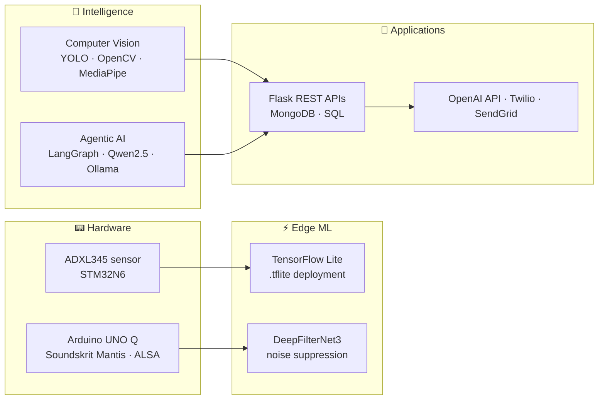

<div align="center">


</div>

<br/>

## `$ whoami`

```bash
$ whoami
asapani-sravani, Junior AI/ML Engineer @ Innotrat Labs, Chennai

$ cat focus.txt
agentic AI   ->  LangGraph · Qwen2.5 · Ollama · tool execution · API integration
edge AI      ->  STM32N6 · Arduino UNO Q · TensorFlow Lite · DeepFilterNet3
vision       ->  YOLO · OpenCV · MediaPipe · real-time video

$ cat education.txt
B.Tech CSE, GIET University (2022-2026), CGPA 8.09/10

$ status
open to work: AI/ML Engineer · Agentic AI · Edge AI
```

<br/>

## 🧭 The spectrum I work across

Most AI engineers live in one layer. I like working across all of them, from a motion sensor on a microcontroller to an LLM agent calling APIs.



<sub>These are the layers I have worked in, shown as a map rather than one single system.</sub>

<br/>

## 🖥️ Currently running

```text
PID   PROCESS                                      STATUS
001   multi-agent RAG with a critic loop           building
002   Docker + GCP deployment                      learning
003   MLOps fundamentals                           learning
004   your next AI/ML problem                      open slot
```

<br/>

## 💼 Work log: Innotrat Labs (Feb 2026 – Present)

| Area | What I built |
|:---|:---|
| 🤖 **Agentic AI** | Workflows with tool execution and API integration using Python, LangGraph, Qwen2.5 and Ollama |
| 📄 **GenAI** | An offer-letter system with the OpenAI API, Flask, PyMuPDF, SendGrid and MongoDB, **cutting turnaround time by 60%** |
| 🔊 **Edge AI audio** | A real-time noise-suppression pipeline on Arduino UNO Q using Soundskrit Mantis, PARDI, ALSA and DeepFilterNet3 |
| 📟 **TinyML** | A sensor pipeline on STM32N6 with an ADXL345: X/Y/Z motion data collection, model training and TensorFlow Lite deployment |

<br/>

## 🧪 Experiments (click to expand)

<details>
<summary><b>🧠 Multi-Agent Document Intelligence</b>: RAG that checks its own answers</summary>

<br/>

- **Idea:** most RAG demos retrieve once and answer. This one adds a critic that rejects unsupported answers and sends them back for another pass.
- **Agents:** planner, retriever, generator and critic, orchestrated as a LangGraph state machine.
- **Models:** Qwen2.5 and local embeddings through Ollama, with a Chroma vector store.
- **Extras:** Flask `/query` API, a keyword-based evaluation harness, and two modes (research-paper Q&A and resume–job-description matching).

`Python` `LangGraph` `Ollama` `Qwen2.5` `ChromaDB` `Flask`

</details>

<details>
<summary><b>🚨 Women Safety Analytics System</b>: real-time threat detection with instant alerts</summary>

<br/>

- **Idea:** spot unsafe situations from live video and raise an alert without anyone having to press a button.
- **Approach:** YOLO object detection and OpenCV on the video stream, plus audio classification, wired to the Twilio REST API for automated alerts.
- **Result:** **over 90% detection accuracy** with **sub-second alerts**.

`Python` `YOLO` `OpenCV` `Audio Classification` `Twilio`

</details>

<details>
<summary><b>🤟 Real-Time Sign Language Detection</b>: gesture recognition with limited data</summary>

<br/>

- **Idea:** recognise hand gestures in real time even when training data is scarce.
- **Approach:** MediaPipe-based feature extraction feeding a deep-learning classifier built in TensorFlow and Keras.
- **Result:** **+20% recognition accuracy** through architecture and hyperparameter optimization, holding up on real-time video input.

`Python` `TensorFlow` `Keras` `MediaPipe` `OpenCV`

</details>

<br/>

## 🧰 Toolbox

| Layer | Tools |
|:---|:---|
| 🧠 **LLMs & Agents** | `LangGraph` `Qwen2.5` `Ollama` `OpenAI API` |
| 👁️ **ML & Vision** | `TensorFlow` `Keras` `Scikit-learn` `YOLO` `OpenCV` `MediaPipe` `NumPy` `Pandas` |
| 📟 **Edge & Embedded** | `TinyML` `TensorFlow Lite` `STM32` `Arduino UNO Q` `ALSA` |
| 🔧 **Backend & Data** | `Python` `SQL` `Flask` `REST APIs` `MongoDB` `Linux` |
| 📈 **Learning now** | `Docker` `GCP` `MLOps` |
| 🎓 **Core CS** | Data Structures & Algorithms · DBMS · Operating Systems · OOP |

<br/>

## 🛤️ Timeline

| When | Milestone |
|:---|:---|
| 2020 – 2022 | Intermediate (MPC), 87.2% |
| Sep 2022 | Started B.Tech in Computer Science and Engineering at GIET University |
| Feb 2026 | Joined Innotrat Labs as Junior AI/ML Engineer |
| May 2026 | Graduated, CGPA 8.09/10 |
| Now | Building multi-agent systems and learning cloud deployment |

<details>
<summary><b>📜 Certifications</b></summary>

<br/>

- SQL and Computer Vision, Infosys Springboard
- Python and Data Science, Udemy
- MySQL Bootcamp, LetsUpgrade
- HackerRank 5-Star Rating in Python

</details>

<br/>

<div align="center">

## 📈 GitHub Activity


<br/><br/>

## 📬 Let's build something

I'm looking for **AI/ML Engineer, Agentic AI and Edge AI roles**.

<a href="mailto:asapanisravani49@gmail.com"></a>
<a href="https://www.linkedin.com/in/asapani-sravani-3234922b7"></a>
<a href="https://github.com/asapani-Sravani"></a>

<br/><br/>


</div>
